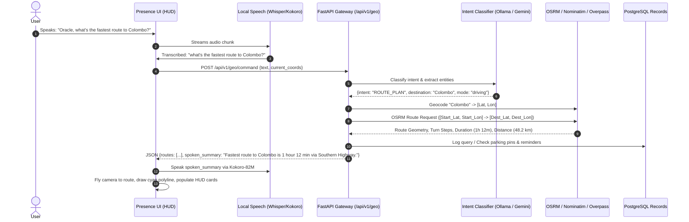

# Maps and Location Intelligence Specification

## Running Atlas

Open **Atlas** from the Oracle workspace or press **N**. Search for a place, then choose a match. Atlas accepts device location or an explicit start selected with **Set as Start**. Add up to eight intermediate stops from search results. Enable optimization to compare the original and recommended stop order using travel times from the routing engine.

- Saved places and parking use the same SQLite or PostgreSQL database as Oracle records. The database migration runs when records initialize. Parking can be replaced or cleared from Atlas.
- Set `ORACLE_OSRM_DRIVING_URL`, `ORACLE_OSRM_WALKING_URL`, or `ORACLE_OSRM_CYCLING_URL` in `backend/.env` or the backend environment. Each URL must point to an OSRM instance built with the corresponding profile. Driving has a public default. Stop optimization uses the instance's duration matrix.
- Set `ORACLE_VALHALLA_URL` for road-network reachability. Without a reachable Valhalla provider, Atlas labels its geometric estimate as approximate.
- Set `VITE_ATLAS_TERRAIN_TILES` in `frontend/.env.local` to a MapLibre-compatible Mapbox RGB DEM tile URL template. Set `VITE_ATLAS_TRAFFIC_TILES` to a transparent raster traffic tile URL template. Use tile providers that permit browser requests from Oracle. Set their attribution text with `VITE_ATLAS_TERRAIN_ATTRIBUTION` and `VITE_ATLAS_TRAFFIC_ATTRIBUTION`, then restart the frontend. Street, Satellite, and Dark are base maps. Traffic and Terrain are optional overlays. For Cycling, configure a transparent raster tile source with `VITE_ATLAS_CYCLING_TILES` and its attribution with `VITE_ATLAS_CYCLING_ATTRIBUTION`. The traffic overlay is independent of the routing engine used to calculate the ETA.
- **Plan from Calendar** uses upcoming timed events with locations from the connected Google primary calendar. Pick the correct map match and set an arrival buffer to calculate a departure time. **Check Route Weather** requests current conditions or an hourly forecast for an upcoming calendar trip at three points along the selected route.
- In **Data**, import multiple GeoJSON layers and toggle, export, or remove them independently. To extrude polygons, import heights in metres in a numeric `height` property and enable extrusion on that layer. Imported layers live for the current Atlas session.
- Arrival reminders are stored locally in the browser. Enable monitoring explicitly after creating a reminder from a pin. Monitoring stops when you pause it or close Atlas.

### Trip planning and navigation

- **Trip Planner** keeps the origin, destination, ordered stops, mode, and arrival buffer together. Pick a saved place or assign a search match or pin. Save a named itinerary in the current browser and reopen it to request a fresh preview.
- **Start Navigation** follows the route while Atlas is open. It shows the next maneuver and remaining distance, can speak prompts, and pauses guidance when the GPS fix is stale or inaccurate. Routes automatically recalculate after repeated off-route fixes, using the current position and keeping unvisited stops in the active route order. Guidance resumes when an accurate, recent GPS fix is available.
- **Trip history** is optional and stores completed-trip summaries on this device. It does not store a GPS trail. Parking photos and floor or landmark notes are stored with the parking record.
- **Place search options** offer English, Sinhala, or Tamil place names and an optional Sri Lanka-only filter. Aliases and locality come from the geocoder where available.
- **Data → Provider Status** shows configured services and runs connection checks on demand. Connection checks indicate reachability, not route coverage.
- Set `ORACLE_VALHALLA_TRAFFIC_URL` for time-dependent driving and enable it in the planner. For calendar trips, the event's time zone or UTC offset should match the destination. Traffic speeds and closures depend on the Valhalla dataset. Stop optimization still uses the OSRM duration matrix, which may differ from Valhalla's estimate.
- To run without Internet access, provision local map and routing datasets separately. Set `VITE_ATLAS_LOCAL_BASEMAP_TILES` to your local raster tile URL template, `VITE_ATLAS_LOCAL_BASEMAP_ATTRIBUTION` to its attribution, and the relevant `ORACLE_OSRM_*_URL` settings to local routing servers. Set `ORACLE_NOMINATIM_URL` for local place lookup. Atlas does not download or bundle offline regions.

Background guidance and geofencing are outside the current implementation. The remaining sections describe the broader product specification.

### GIS and location context

- In **Data**, import GeoJSON, KML placemarks, GPX waypoints and tracks, or CSV points with longitude and latitude columns. Inspect a layer or click a feature on the map to view its attributes. Attribute and spatial filters update the map and table together.
- Select a buffer, reachability area, imported polygon, or measured polygon to find intersecting features. Boundary contact counts. Export matches as GeoJSON or an attribute CSV.
- Filter features within a corridor around an active route or a selected line from an imported layer. For single-destination OSRM routes, **Check Detours** estimates the added travel time of the three points closest to the line and displays matches within your time limit.
- **Save GIS Project** downloads a local project file. Reopen it from **Import Layer or Project** to restore its layers, visibility, extrusion, filters, measurements, reference areas, and viewport. Project import replaces the current GIS session.
- Under **What's around me?**, choose device location, a selected pin, or the map center. Nearby results show direction and straight-line distance. **Check Walking Time** requests a separate road-network estimate.
- Open **Terrain and elevation** on a route preview to sample an elevation profile and compare ascent across route alternatives. Ascent and grades are approximate because they come from sampled terrain.

## 1. Overview & JARVIS-Inspired Design Philosophy

Rather than a detached, static map viewer, ORACLE incorporates a **Maps & Location Intelligence Module** designed as an integrated spatial cognitive system. The interface follows ORACLE's cinematic tactical HUD aesthetic: dark glassmorphic surfaces (`#0a0e17`), legible typography, and restrained cyan accents (`#00f3ff`).

Users interact naturally across three continuous modalities:
- **Spoken Voice:** Real-time push-to-talk speech understanding with Faster-Whisper and expressive vocal responses via Kokoro-82M.
- **Natural Language Text:** Natural, conversational destination and route queries via Ollama / Gemini intent routing.
- **Direct Visual Manipulation:** High-performance, vector-rendered interactive maps with route comparison cards, live markers, and 3D building extrusions.

### Example Interactions
- *"Oracle, show me the nearest hospital."*
- *"Oracle, what's the fastest route to Colombo?"*
- *"Oracle, show traffic conditions along my route."*
- *"Oracle, remember where I parked."*
- *"Oracle, find a quiet café with Wi-Fi near campus."*

---

## 2. Feature Inventory & Priorities

| Feature ID | Feature Name | Description | Priority | Stream / Audit ID |
| :--- | :--- | :--- | :--- | :--- |
| **GEO-01** | **Interactive Map Canvas** | Vector map rendering with smooth zoom, pan, pitch, tilt, satellite tile overlay, and custom HUD markers. | **Essential** | L01, L02 |
| **GEO-02** | **Smart Location Search** | Natural language place discovery and reverse-geocoding (e.g. "quiet library near Galle Road"). | **Essential** | L05 |
| **GEO-03** | **Route Planning** | Turn-by-turn path calculation supporting driving, walking, and cycling modes. | **Essential** | L07 |
| **GEO-04** | **Location Awareness** | Browser HTML5 Geolocation / OS location with strict opt-in permission and clear visual indicators. | **Essential** | L01, U01 |
| **GEO-05** | **Multi-Route Comparison** | Simultaneously computes primary and alternative paths, comparing distance, duration, and terrain. | **High** | L07 |
| **GEO-06** | **Nearby POI Search** | Contextual search for essential services: hospitals, pharmacies, fuel, ATMs, and restaurants. | **High** | L05 |
| **GEO-07** | **Voice Navigation & Control** | Full voice control for map viewport, route initiation, waypoint query, and spoken navigation prompts. | **High** | L08, A02 |
| **GEO-08** | **Saved Places & Pins** | Persistent bookmarks for Home, Campus, Work, and spatial memory pins with custom tags and notes. | **High** | L02, L03 |
| **GEO-09** | **Parking Memory** | One-touch spatial anchor: stores GPS coordinates, photo capture, floor/pillar note, and walk-back route. | **High** | L04 |
| **GEO-10** | **Live Traffic & Congestion** | Route segment coloration indicating estimated congestion, slowdowns, and road closures. | **Advanced** | L11 |
| **GEO-11** | **Weather Overlay** | Destination and en-route precipitation, temperature, and wind vector overlays. | **Advanced** | J07, J20 |
| **GEO-12** | **Multi-Stop Route Optimization** | Traveling salesperson heuristic to order multiple waypoints efficiently for daily errands. | **Advanced** | SC-38, R02 |
| **GEO-13** | **3D Geographic Exploration** | 3D building polygon extrusions, terrain elevation, and animated camera flight paths. | **Advanced** | L08 |
| **GEO-14** | **Location-Based Reminders** | Geo-fenced task triggers: alerts when entering or exiting a designated radius around a place. | **Advanced** | L09, R01 |
| **GEO-15** | **Emergency Assistance** | Rapid one-click / voice command to lock on closest emergency rooms with contact and 1-tap route. | **Advanced** | S01, L05 |
| **GEO-16** | **Local Location History** | Opted-in, strictly on-device historical trip logging with granular timeline browsing and full deletion. | **Advanced** | L10, M09 |
| **GEO-17** | **Journey & Leave-Time Briefings** | Synthesizes calendar departure deadlines, live route estimates, and weather warnings into spoken briefing. | **Advanced** | L11, L12 |

---

## 3. UI Layout & Visual Architecture

The interface is structured into three coordinated functional zones within the ORACLE Presence ecosystem:

```
+---------------------------------------------------------------------------------------------------+
|  ORACLE / GEO INTELLIGENCE                                                      [LIVE] [GPS: ON]  |
+------------------------------------+----------------------------------+---------------------------+
| 1. ASSISTANT PANEL                 | 2. VOICE / TEXT / CONTEXT HUD    | 3. MAPS & 3D CANVAS       |
|                                    |                                  |                           |
| [Search Destination: Colombo...  ] | [Active Intent: NavigateRoute]   | [ Vector MapLibre Canvas ]|
|                                    |                                  |                           |
| Suggested Quick Actions:           | "Oracle, what's the fastest      |   +--[Cyan Route Path]--+ |
| - [Nearby Hospitals (Emergency)]   |  route to Colombo?"              |   |                     | |
| - [Navigate to University]         |                                  |   [Alt 1: 1h 12m]       | |
| - [Where did I park?]              | Oracle Voice Output:             |   [Alt 2: 1h 24m]       | |
| - [Plan errand loop]               | "Route 1 via Southern Highway    |                           |
|                                    | is fastest at 1 hour 12 min.     |   [Parking Pin Dropped]   |
| Active Route Card:                 | Traffic is moderate near Kottawa.|   [3D Building Extrusions]|
| - Primary: 48.2 km | 1h 12m       | Showing 2 alternate paths."      |                           |
| - Steps: Turn left onto A2...      |                                  | [Layer Controls: Sat/3D]  |
|                                    | [Voice Waveform: Kokoro active]  | [Compass] [Recenter GPS]  |
+------------------------------------+----------------------------------+---------------------------+
```

### Aesthetic Specifications
- **Backgrounds:** Deep Obsidian/Navy glassmorphism (`rgba(10, 14, 23, 0.85)` with `backdrop-filter: blur(16px)`).
- **Accents:** Neon Cyan (`#00f3ff`) for active routes and selected nodes; Subtle Amber (`#ffb700`) for traffic warnings and caution alerts.
- **Typography:** High-contrast monospaced headers for telemetry (`JetBrains Mono` or `Space Grotesk`) and clean sans-serif for route descriptions.
- **Tactile Feedback:** Smooth vector camera pans (`flyTo`), micro-interactions with audio synthesis ticks from `sfx.ts`.

---

## 4. Free and Open-Source Technology Stack

To maintain ORACLE's commitment to **zero-paid services, private local execution, and open-source foundations**, the geospatial stack leverages:

| Component | Technology | Rationale & Operational Boundaries |
| :--- | :--- | :--- |
| **Map Rendering Engine** | **MapLibre GL JS** | Open-source fork of Mapbox GL. High-performance WebGL/WebGPU vector rendering with 3D extrusions and custom dark styles without proprietary API tokens. |
| **Geographic Base Data** | **OpenStreetMap (OSM)** | Free, globally crowdsourced map data. CartoDB Dark Matter / Stadia / OpenFreeMap vector tiles for dark mode styling. |
| **Geocoding & Place Search** | **Nominatim / Photon** | Open-source geocoders powered by OSM. Local instance support or rate-limited compliant public queries with user-agent attribution. |
| **Routing & Optimization** | **OSRM / Valhalla** | Open Source Routing Machine or Valhalla for driving, walking, and cycling route matrices, turn-by-turn maneuvers, and multi-stop TSP. |
| **POI & Feature Queries** | **Overpass API** | Rich structured OSM queries for nearby amenities (amenity=hospital, amenity=cafe, fuel, etc.). |
| **3D Elements & AR** | **MapLibre 3D + Three.js** | Custom 3D directional arrows, camera navigation overlays, and extruded landmark geometry. |
| **Persistence Layer** | **PostgreSQL / PostGIS (or SQLite)** | Stores saved places, parking memories, trip logs, and geofenced triggers alongside existing ORACLE records. |
| **Voice Processing** | **Faster-Whisper + Kokoro-82M** | Local push-to-talk speech-to-text with Silero VAD and low-latency neural text-to-speech for navigation cues. |

---

## 5. Intent Flow & Processing Architecture



---

## 6. Phased Implementation Roadmap

### Phase 1 — Map Foundation
- [ ] Install and configure **MapLibre GL JS** inside `frontend/`.
- [ ] Implement dark-themed vector tile style (OSM / OpenFreeMap / Carto Dark).
- [ ] HTML5 Geolocation binding with permission guard, accuracy badge, and recenter button.
- [ ] Forward geocoding search input with debounced Nominatim / Photon lookup.
- [ ] Basic single-route rendering (OSRM driving directions polyline and turn cards).

### Phase 2 — Oracle Integration & Voice
- [ ] Voice navigation hooks: wire Whisper transcription keywords ("navigate to", "where is", "route to", "find nearest") to map commands.
- [ ] Spoken navigation briefings via Kokoro-82M neural TTS.
- [ ] Nearby amenities query tool via Overpass API (hospitals, fuel, cafes, ATMs).
- [ ] Saved places database model (`places` table in PostgreSQL) with quick-access HUD chips.
- [ ] Parking memory module (`POST /api/v1/geo/parking`): stores GPS, snapshot image, and floor note with one-click return path.

### Phase 3 — Advanced Intelligence & Proactivity
- [ ] Multi-route comparison: render primary cyan route vs dimmed alternate paths with relative time differences (`+12 min`).
- [ ] Multi-stop route optimizer (traveling salesperson reordering for daily errands).
- [ ] 3D building extrusions and cinematic camera pitch (`pitch: 50`, `bearing: 30`).
- [ ] Geofenced location reminders (Stream 14 integration): trigger task notifications upon reaching saved place coordinates.
- [ ] Emergency Quick-Lock: instant command *"Oracle, emergency"* locks onto closest medical center with contact info and urgent route.
- [ ] Leave-time suggestions engine: cross-references Google Calendar / Tasks with live route duration and departure countdowns.

---

## 7. Data Models & API Specifications

### Database Schema (PostgreSQL)

```sql
-- Saved Places
CREATE TABLE IF NOT EXISTS geo_places (
    id UUID PRIMARY KEY DEFAULT gen_random_uuid(),
    name VARCHAR(100) NOT NULL,
    category VARCHAR(50) DEFAULT 'custom', -- 'home', 'work', 'campus', 'hospital'
    latitude DOUBLE PRECISION NOT NULL,
    longitude DOUBLE PRECISION NOT NULL,
    address TEXT,
    notes TEXT,
    created_at TIMESTAMP WITH TIME ZONE DEFAULT NOW()
);

-- Parking Records
CREATE TABLE IF NOT EXISTS geo_parking_records (
    id UUID PRIMARY KEY DEFAULT gen_random_uuid(),
    latitude DOUBLE PRECISION NOT NULL,
    longitude DOUBLE PRECISION NOT NULL,
    floor_level VARCHAR(30),
    landmark_note TEXT,
    image_memory_id UUID REFERENCES visual_memories(id) ON DELETE SET NULL,
    is_active BOOLEAN DEFAULT TRUE,
    created_at TIMESTAMP WITH TIME ZONE DEFAULT NOW()
);

-- Location-Based Reminder Triggers
CREATE TABLE IF NOT EXISTS geo_reminders (
    id UUID PRIMARY KEY DEFAULT gen_random_uuid(),
    task_id UUID NOT NULL,
    place_id UUID REFERENCES geo_places(id) ON DELETE CASCADE,
    latitude DOUBLE PRECISION NOT NULL,
    longitude DOUBLE PRECISION NOT NULL,
    radius_meters INTEGER DEFAULT 150,
    trigger_on VARCHAR(10) DEFAULT 'enter', -- 'enter', 'exit'
    is_active BOOLEAN DEFAULT TRUE,
    created_at TIMESTAMP WITH TIME ZONE DEFAULT NOW()
);
```

### API Endpoints
- `POST /api/v1/geo/geocode`: Search addresses and POIs via natural language.
- `POST /api/v1/geo/route`: Compute primary and alternative routes between waypoints.
- `GET /api/v1/geo/nearby`: Query POIs (hospitals, food, fuel) within a given radius.
- `GET /api/v1/geo/places`: List saved user places.
- `POST /api/v1/geo/places`: Create a new saved place.
- `POST /api/v1/geo/parking`: Save current location and optional image as the active parking anchor.
- `GET /api/v1/geo/parking/active`: Retrieve current parking position and return route.
- `POST /api/v1/geo/evaluate-triggers`: Match client GPS coordinates against active geo-reminders and return pending suggestion alerts.
