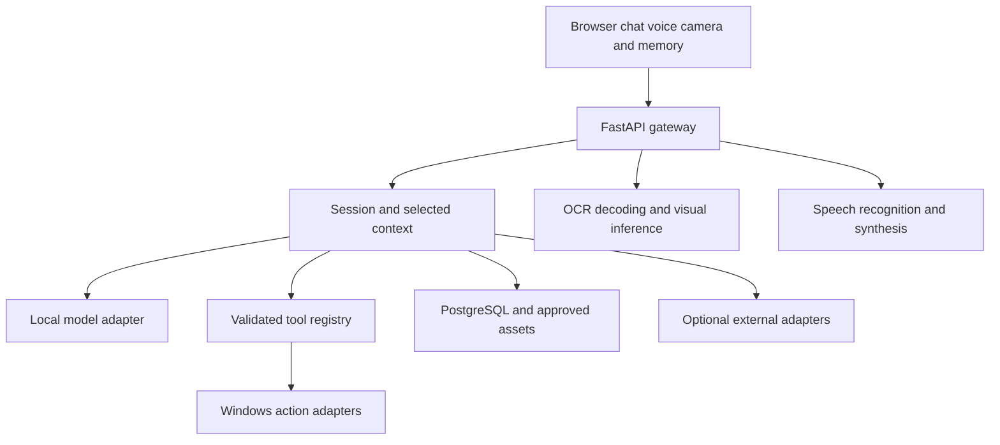

# ORACLE zero cost technology and architecture

Updated 3 November 2026. Proposed starting design, subject to a small feasibility check on the development laptop. No application implementation is claimed complete.

Implementation update: the gateway and interface now work, and the user has explicitly enabled Gemini cloud text conversation while Ollama is deferred. This is a temporary exception to the local-only starting plan below. See [development status](DEVELOPMENT_STATUS.md) for tested behaviour, credential handling and request limits.

## Budget and operating model

Start with the existing Windows laptop, its camera and microphone, and a browser interface. No paid hosting, domain, subscription, cloud AI billing account or additional hardware is required by this plan. Electricity, connectivity, storage and model downloads still consume resources. Software and model licenses remain applicable even when there is no payment.

The local assistant and approved memory should work without internet after required models are downloaded. Fresh product information, weather, encyclopedia search and map tiles require connectivity. A stopped or sleeping laptop cannot be assumed to deliver reminders. The application must explain these limits.

## Starting technology choices

| Area | Starting choice | Use and timing |
|---|---|---|
| Interface | React, TypeScript and Vite | Chat, controls, camera preview and memory cards; Phase 1 |
| Styling | Plain CSS with shared colour tokens | Adapt existing dark cyan and teal references; Phase 1 |
| Backend | Python, FastAPI, Uvicorn and Pydantic | Validated requests, sessions and registered actions; Phase 1 |
| Communication | REST first; WebSocket for streaming | Records and uploads through REST; response and status events through WebSocket |
| Local language inference | Ollama with one small compatible local model | Phase 2; choose model after RAM and latency checks |
| Storage | PostgreSQL through SQLAlchemy 2; Alembic migrations | Backend-owned notes/tasks and normalized approved image memories; SQLite retained for compatibility/source recovery |
| Windows actions | Python subprocess with fixed arguments, webbrowser and pathlib | Open configured programs, websites and permitted files |
| System status | psutil when needed | Read CPU, RAM, battery and storage information |
| Windows UI automation | pywinauto only when needed | Supported controls that cannot use a direct application interface |
| Image processing | Pillow and OpenCV | Validated still decode/orientation/crop, local QR preview and normalized approved image storage; Phases 4/5 |
| OCR | RapidOCR ONNX Runtime, packaged models on CPU | Implemented local backend reading; English first; physical printed-label acceptance remains open |
| Barcode decoder | Evaluate ZXing through a maintained binding | Add after QR and OCR; verify Windows packaging and supported code types |
| Speech input | faster-whisper, tiny English CPU int8 | Implemented backend transcription, explicit utterance and transcript review; human microphone test deferred |
| Speech output | Installed Windows SAPI voice | Implemented offline backend WAV synthesis/client playback; no new voice download |
| Document text | pypdf | Text PDFs first; scanned pages use the OCR path later |
| Search | PostgreSQL keyword search first | Establish a baseline before adding embeddings |
| Semantic search | Sentence Transformers and local similarity search | Later experiment; a separate vector database is optional |
| Maps | Leaflet and a policy compliant tile provider | Optional saved-place demonstration after the core journey |
| Verification | pytest; frontend behaviour tests when needed | Focus on action boundaries, storage lifecycle and user journeys |

Do not install every candidate at once. Use a Python virtual environment, a frontend lockfile and tested dependency versions. Check the current Vite Node requirement and choose a Python version supported by the selected inference packages. Avoid choosing a new runtime version solely because it is the newest.

## Proposed architecture

Use one modular backend rather than separate distributed services. Ollama is a local inference service accessed by the backend. The browser never calls operating system actions directly.

| Module | Responsibility |
|---|---|
| api | Input validation, authentication, request IDs, errors and upload limits |
| assistant | Local model adapter, bounded context and response generation |
| tools | Tool schemas, allowed targets, confirmations, timeouts and outcomes |
| desktop | Windows program, permitted path, screenshot and status operations |
| vision | Selected image crop, QR or barcode decoding, OCR and optional visual model |
| memory | Approved source records, retrieval, evidence, corrections and deletion |
| productivity | Notes, tasks, timer and persistent reminder due times |
| voice | Capture format validation, transcription, speech and stop |
| integrations | Explicit optional internet lookups with caching and failure handling |

### Request flow

1. The user submits text, an utterance or a selected image.
2. The backend attaches session context and validates the request.
3. The assistant answers, asks for clarification or proposes a registered action.
4. The tool service validates the target and parameters and obtains confirmation when needed.
5. The result reports success, failure or partial completion from the actual operation.
6. Only an explicit save or clearly enabled storage policy creates a persistent memory.

Start camera analysis with manual still captures and touch selection. A text-only model cannot understand images: OCR and decoding cover specific tasks, while general image questions need a compatible local vision model. Benchmark that model separately before promising broad object recognition. Continuous detection, gestures and learned attention are later additions.

### Minimum safeguards from the beginning

- Bind development services to loopback and avoid exposing Ollama or desktop actions to the network.
- Authenticate action-capable backend requests; validate browser origins as an additional check.
- Map application names to configured executable paths. Never execute model generated shell strings.
- Limit local file access to selected directories; validate resolved paths.
- Preview sending, sharing, deleting, overwriting and power actions before execution.
- Give actions request IDs, deadlines and duplicate prevention. Reconnect must not repeat side effects.
- Stop microphone and camera tracks on revocation; do not persist raw streams by default.
- Treat instructions inside documents, OCR and web results as untrusted content.
- Link approved memories, thumbnails and derived search entries so edits and deletion propagate.

## Free internet adapters

These are optional services, not unlimited infrastructure. Check policies again before integrating and display required attribution.

| Service | Use | Access and constraints |
|---|---|---|
| Open Food Facts | Barcode product information | Public reads; identify the app, obey endpoint rate limits and attribution requirements; missing products are normal |
| MediaWiki APIs | Wikipedia search and reference content | Public read endpoints; follow access policies and attribute reused content |
| Open-Meteo | Weather | Free API for noncommercial use within published limits; cache suitable results |
| OpenStreetMap standard tiles | Map background | Follow attribution, caching and usage rules; no bulk offline prefetch |
| Nominatim public service | Occasional place-name lookup | Maximum 1 request per second, identifying client and attribution; no client-side autocomplete |

For general web search, initially open an encoded search query in the browser. This does not provide an automatic cited web-answer pipeline. Do not rely on unofficial search scraping as a stable free API. Calendar export can begin with a local ICS file, avoiding a cloud integration in the first version.

A map library does not itself provide routing, nearby-place search or offline maps. Evaluate those service adapters only when their features enter scope. The same applies to specialist food, plant and chess recognition.

## Selection and cost rules

Do not enable paid cloud fallback or automatic purchases. Start without API keys where possible. A public service failure should leave local capabilities usable. Select one model at a time and measure actual RAM, warm response time and failure rate. Exact language coverage, model weights, voice files and redistribution terms need individual checks. Ultralytics detection and Piper have copyleft licensing considerations; review them before distributing a combined application.

## Official references

Reviewed for this planning update on 3 November 2026. These links explain the tools and policies; they do not verify installation or performance on this laptop.

- [Vite setup and runtime prerequisites](https://vite.dev/guide/)
- [FastAPI documentation](https://fastapi.tiangolo.com/)
- [Ollama local operation and cloud disabling](https://docs.ollama.com/faq)
- [Python SQLite](https://docs.python.org/3/library/sqlite3.html)
- [faster-whisper](https://github.com/SYSTRAN/faster-whisper)
- [Piper](https://github.com/OHF-Voice/piper1-gpl)
- [OpenCV](https://docs.opencv.org/4.x/)
- [EasyOCR](https://github.com/JaidedAI/EasyOCR)
- [Sentence Transformers](https://sbert.net/docs/quickstart.html)
- [pywinauto](https://github.com/pywinauto/pywinauto)
- [Leaflet](https://leafletjs.com/)
- [Open Food Facts API](https://github.com/openfoodfacts/openfoodfacts-server/blob/main/docs/api/index.md)
- [MediaWiki REST API](https://www.mediawiki.org/wiki/API:REST_API/Get_started)
- [Open-Meteo terms](https://open-meteo.com/en/terms)
- [OSM tile policy](https://operations.osmfoundation.org/policies/tiles/)
- [Nominatim policy](https://operations.osmfoundation.org/policies/nominatim/)
- [Ultralytics licensing](https://www.ultralytics.com/license)

## Implemented prototype services (2026-11-04)

- Browser media/speech APIs provide opt-in recognition, read-aloud, local audio-level analysis, camera preview/file capture and capability-dependent focus/switching.
- TensorFlow.js 4.22.0, COCO-SSD 2.2.3 and face-detection 1.0.3 provide local opt-in object/face inference. Official public model weights are hosted locally after the setup script; raw images are not uploaded. A pinned TFJS face-adapter import and scoped patched build-tool override are covered by real inference tests.
- A single lazy vision bundle preserves TensorFlow initialization ordering; it is separate from initial UI code. This is an intentional size/performance tradeoff, not an always-loaded dependency.
- Browser-local timestamped tasks power timers/reminders, in-app queue/snooze and the Up Next view. There is no external calendar or background scheduler claim.
- Open-Meteo geocoding/forecast provides real selected-city weather under its free non-commercial terms, with attribution and explicit data-flow disclosure.
- Optional audio cues use Web Audio; speech state follows browser speech events. Microphone bars use measured RMS instead of the prototype's synthetic voice envelope.
- Note: The prototype UI implementation and audit have been deleted.
